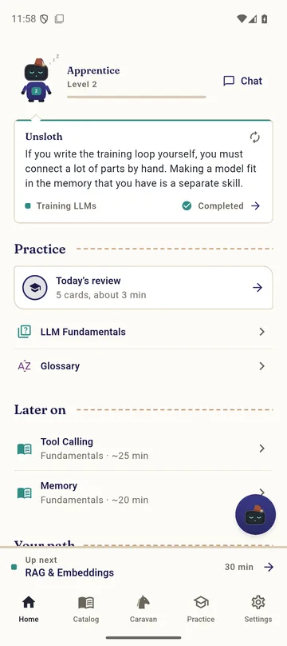
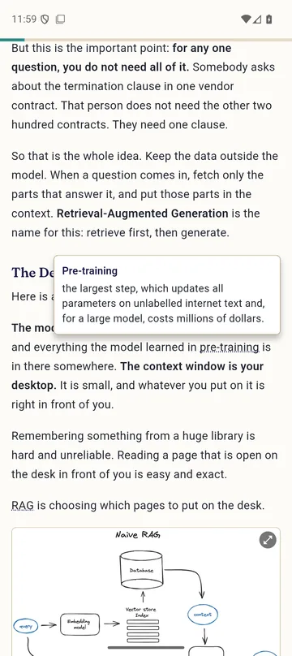
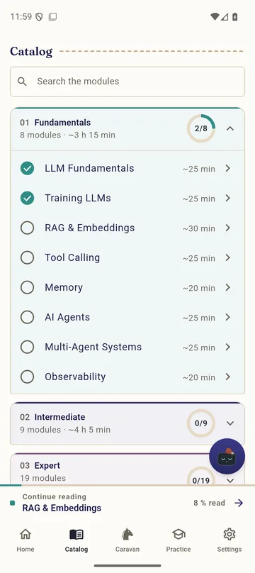
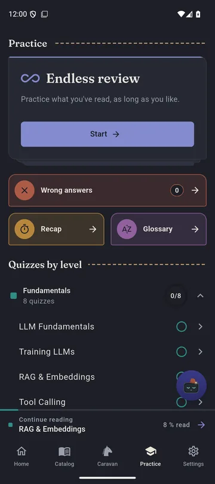
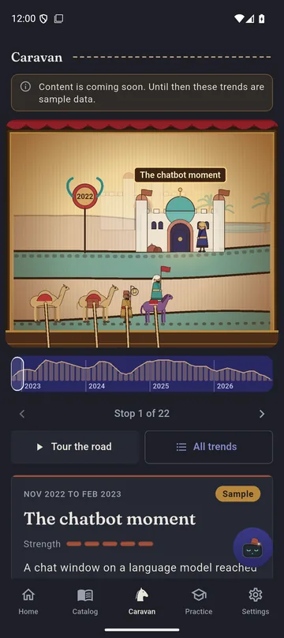
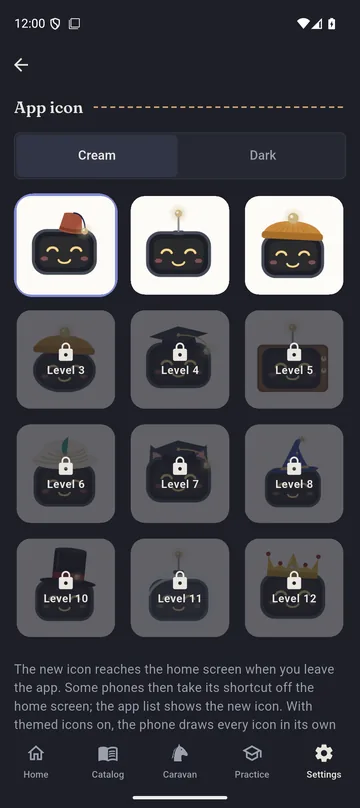

# AI Engineering Bazaar mobile

[](https://opensource.org/licenses/MIT)

The [AI Engineering Bazaar](https://ai-bazaar.lokum.dev/) course as an app for Android and iOS: short, practical modules on AI engineering, readable offline, in English, Turkish and Persian.
The course is written in the web repo, [lokumai/ai-engineering-bazaar](https://github.com/lokumai/ai-engineering-bazaar); the app reads what the site publishes.
No account, no ads, no tracking.

<table>
  <tr>
    <td align="center"><br><sub>Home</sub></td>
    <td align="center"><br><sub>The reader</sub></td>
    <td align="center"><br><sub>Catalog</sub></td>
  </tr>
</table>

## What is in it

- **Welcome.** The Apprentice, the app's small robot in a fez, opens the bazaar; the first launch asks for the language, the track (For Engineers or For Everyone) and Light or Dark, with the story of the Bazaar one tap away.
- **Home.** The Apprentice's corner with the day's card from a module, Practice (Today's review, a quiz waiting, the glossary), the modules later on, and a band to go on reading.
- **Catalog.** Every level with your progress, and a search over the modules' titles, headings and text.
- **The reader.** Contents, quiz and checklist; images and diagrams full screen; the glossary's terms dotted in the text, a tap shows the definition; **Listen** reads the module aloud with the phone's own voice, offline with a voice installed for the language; text size and line spacing.
- **Practice.** An endless review of questions and terms, Wrong answers, Recap, the Glossary and the quizzes by level.
- **Caravan.** A shadow play along the road of AI engineering's trends since 2022 (the trends ride in the app until the content bundle carries them, so a new one comes with an app update).
- **The Apprentice.** A tiny language model that trains on the phone; as it rises in level its wardrobe opens, and each robot can be the app icon, on a cream or dark ground.
- **A tour** of the app on a first run, taken again from Settings.
- **Three languages:** English, Turkish and Persian (right to left); a module not yet translated opens in English.
- **Offline first.** The course ships as a snapshot of the site's content bundle; a newer one downloads in the background, checked by sha256, and is used only once complete.
- **Your progress stays on the device,** in the web's record format: back it up, restore it from the website's file, or reset it.

<table>
  <tr>
    <td align="center"><br><sub>Practice</sub></td>
    <td align="center"><br><sub>Caravan</sub></td>
    <td align="center"><br><sub>App icons</sub></td>
  </tr>
</table>

## Build and run

You need [fvm](https://fvm.app/) with Flutter 3.47.7, JDK 17 for Android and Xcode for iOS.

```shell
fvm flutter pub get
fvm flutter run --target lib/main/main_prod.dart        # content from https://ai-bazaar.lokum.dev/
fvm flutter run --target lib/main/main_local.dart --dart-define=CONTENT_BASE_URL=https://ai-bazaar.lokum.dev/
```

`main_local` takes any https preview of the site as `CONTENT_BASE_URL`, with its trailing slash.
The bundled snapshot is refreshed with `tool/refresh_content_snapshot.dart`, then `tool/generate_tokens.dart`; never by hand.
On the maintainers' machine builds and full test runs go through `heavy `, a shared memory cap; elsewhere run them as they are.
Running on your own iPhone, the content refresh, strings, tests and the commit gate: [docs/development.md](docs/development.md); the architecture and its rules: [CLAUDE.md](CLAUDE.md).
What is done and what is next: [docs/plan.md](docs/plan.md); what changed: [CHANGELOG.md](CHANGELOG.md).

## Privacy and crash reports

The app collects no personal data; the site's [privacy note](https://ai-bazaar.lokum.dev/legend/#privacy) covers it too.
Only a prod release built with a Sentry DSN sends anything: crash reports, hangs, how long the app took to open, release-health sessions, and what a reader sends under Report a problem.
Every report is scrubbed on the device; the Sentry project is in the EU region and keeps no IP address. No route names, screenshots, replay or other traces are sent.
The DSN stays out of git, in a `sentry_dsn.json` beside `pubspec.yaml`:

```shell
echo '{"SENTRY_DSN": "<the project DSN>"}' > sentry_dsn.json
fvm flutter build appbundle --release --target lib/main/main_prod.dart --dart-define-from-file=sentry_dsn.json
```

On Android, Scan the code is Google's code scanner from Google Play services, which sends Google the device's model and system, the app's version, an installation id and how the scan went, as Google's own record.
Feedback in Settings opens the web's anonymous Google Form in the browser; the app sends nothing to it.
What each store's form declares: [docs/store-privacy.md](docs/store-privacy.md).

## Contributing

A mistake in a module belongs to the [web repo](https://github.com/lokumai/ai-engineering-bazaar); something the app shows wrong belongs here.
See [CONTRIBUTING.md](CONTRIBUTING.md).

## Licence

The app is under the [MIT License](LICENSE).
Vazirmatn and Fraunces are under the SIL Open Font License ([assets/fonts/OFL.txt](assets/fonts/OFL.txt), [assets/fonts/OFL-Fraunces.txt](assets/fonts/OFL-Fraunces.txt)).
The course content is under the web repo's licence.
